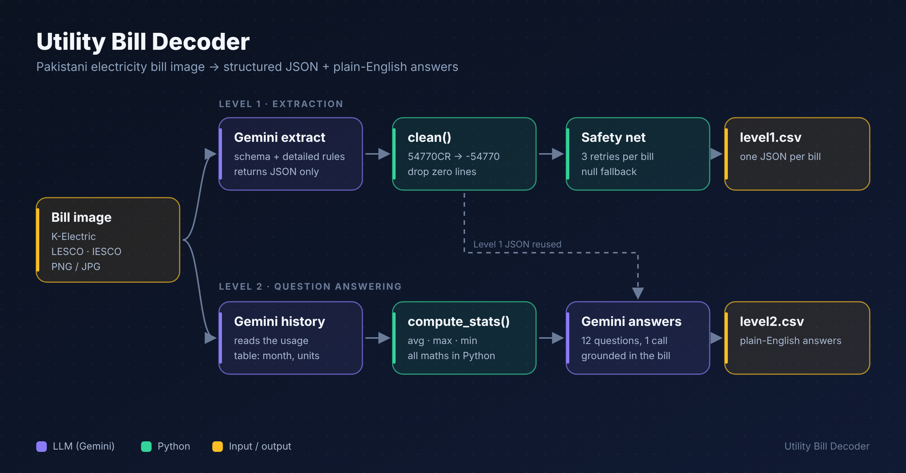
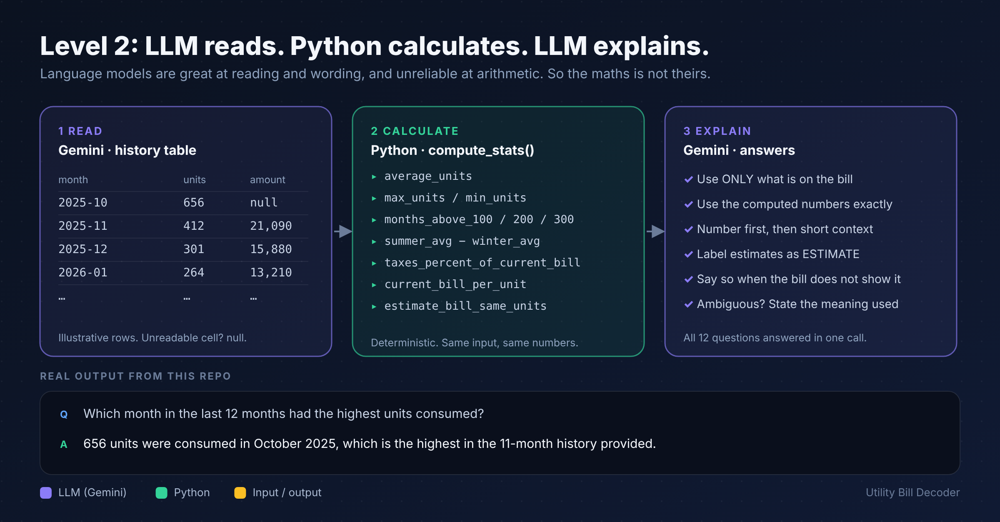
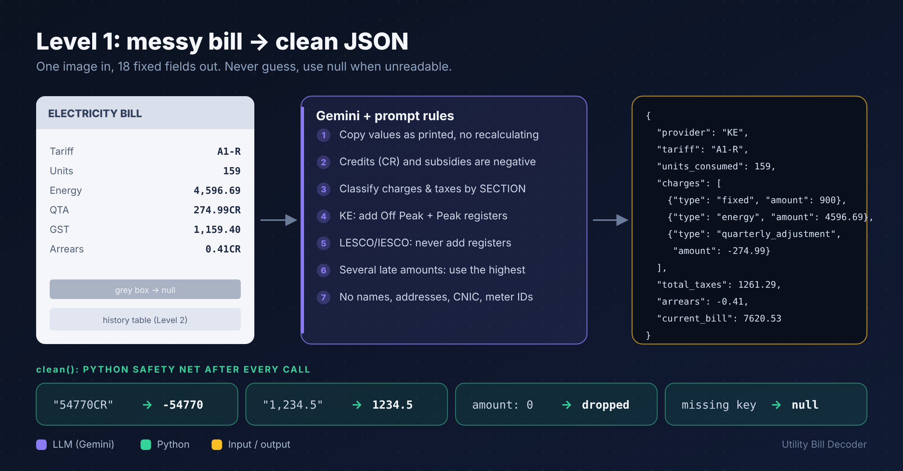

# ⚡ Utility Bill Decoder

Turn a photo of a Pakistani electricity bill (**K-Electric, LESCO, IESCO**) into structured data and plain-English answers, using Gemini for reading and Python for every calculation.



- **Level 1:** one JSON object per bill (provider, tariff, dates, readings, charges, taxes, payable amounts).
- **Level 2:** plain-English answers to customer questions about each bill.

## Why it works

**The model never does the maths.** Language models read and word things well but slip on arithmetic, so Gemini only reads the bill and writes the answer. Averages, counts, percentages and estimates come from `compute_stats()` in Python.



**Extraction is rule-driven and defensive.** A detailed prompt pins down how to treat credits, register readings, tax classification and privacy, and `clean()` repairs whatever still comes back wrong.



## Quick start

Python 3.11+ (developed on 3.13).

```bash
cd source
python -m venv venv
source venv/bin/activate        # Windows: venv\Scripts\activate
pip install -r requirements.txt
cp .env.example .env            # then put your real API key in .env
```

```bash
python main.py <bills_dir> <level1_template.csv> <level2_template.csv> <output_dir>

# example
python main.py ../test/bills ../test/csv/level1.csv ../test/csv/level2.csv ../output
```

This writes `level1.csv` and `level2.csv`, keeping `bill_id`, `question_id`, `question` and row order from the templates. Sample results are in [`output/`](output/).

### Environment variables

| Variable | Value |
|---|---|
| `MODEL_PROVIDER` | `google` |
| `MODEL_NAME` | `gemini-3.1-flash-lite` |
| `API_KEY` | Google AI Studio API key (placeholder in `.env.example`) |

## How it works

1. **Level 1 extraction.** The bill image and a detailed prompt go to the model, which returns JSON. `clean()` converts strings such as `54770CR` to numbers, removes zero or blank lines and makes sure every field exists.
2. **Level 2 answers.** A second call extracts the history table (month, units, amount). Python computes all statistics. The model then receives the image, the Level 1 JSON, the history and the computed numbers, and answers all 12 questions in one call, grounded only in the bill.
3. **Robustness.** Each bill is retried up to 3 times (including rate limits). If it still fails, safe fallback values are written, so the CSVs never contain empty cells and one bad bill never stops the run.

## Design decisions and limitations

- K-Electric bills with separate Off Peak and Peak registers use the sum of both. For LESCO and IESCO the register whose difference equals the billed units is used. Import/Export registers are ignored.
- If a bill prints only one combined tax amount, `taxes` is `[]` and the amount goes in `total_taxes`.
- Blurry or tilted photos may produce a `null` rather than a guess.

## AI usage

- **Model in the solution:** Google Gemini 3.1 Flash-Lite (`gemini-3.1-flash-lite`) via the Google AI Studio API (free tier). No other LLM is called.
- **Services:** Google AI Studio (API key), Google Colab (development).
- **OCR libraries / invoice-extraction services:** none.
- **AI tools used to help write the code:** Claude (Anthropic) for guidance, prompt design and code drafting.

## Repo layout

```
source/        main.py, requirements.txt, .env.example
output/        sample level1.csv and level2.csv
docs/images/   diagrams (SVG + PNG, 1200x627)
```
